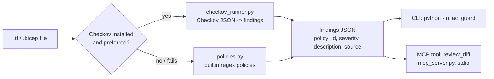

# iac-guard-mcp


[](docs/ci/demo.yml)

**IaC `review_diff` for agents: Checkov (optional) or builtin regex policies over Terraform/Bicep — structured findings JSON.**

> Who it's for: Cloud security + platform SAs embedding IaC review into agent workflows.

## Why this exists

PR bots that only say "looks fine" are useless. `iac-guard` reviews fixtures (or diffs) for classic Azure foot-guns — open NSGs, public blobs — and returns findings plus a static explanation template agents can cite.

## Install

```bash
python -m venv .venv && source .venv/bin/activate
pip install -e .
# optional MCP SDK transport:
pip install -e ".[mcp]"
# optional Checkov:
pip install checkov
```

Or with pipx (once published to PyPI): `pipx install iac-guard-mcp` — until then use editable install from this repo.

## 30-second demo

```bash
python -m iac_guard --help
python -m iac_guard fixtures/bad_nsg.tf || true
python -m iac_guard fixtures/bad_nsg.bicep || true
```

Or simply:

```bash
make demo
```

## What it is NOT

- Not a full OPA / Gatekeeper platform
- Not an auto-remediator that runs terraform apply
- Not a substitute for org policy + Defender for Cloud

## Design & Engineering

I designed this so an agent reviewing infrastructure code can point at a specific policy finding instead of saying "looks fine".

**Design goals**

- Review Terraform and Bicep for classic Azure foot-guns (SSH open to the internet, public blob access).
- Return structured findings JSON plus a plain explanation that agents can cite.
- Work with no extra tools installed, and get better when Checkov is available.
- Expose the same review as an MCP tool for Cursor or any MCP host.

**Architecture**




**Key design decisions and trade-offs**

| Decision | Why | Trade-off |
|---|---|---|
| Builtin regex policies as the floor | Zero dependencies; always returns something useful | Regex can't follow modules or variables like a real parser |
| Checkov optional, with fallback | Full rule coverage when installed; a timeout or missing binary never breaks the review | Two code paths to keep consistent |
| Same findings schema for CLI and MCP | One contract for humans, CI and agents | The schema has to stay stable |
| Review only, never `terraform apply` | Safe to give to an agent | Fixes are still a human step |

**Engineering details**

- **Stack:** Python 3.10+, optional `mcp` SDK extra (`pip install -e ".[mcp]"`), optional Checkov.
- **Builtin policies:** `NSG-SSH-OPEN` (port 22 from `*`) and `STORAGE-PUBLIC-BLOB`, for both Terraform and Bicep syntax.
- **Fixtures:** `fixtures/bad_nsg.tf` and `fixtures/bad_nsg.bicep`.
- **CI:** `make demo` checks findings are produced for both fixtures; workflow template in [`docs/ci/demo.yml`](docs/ci/demo.yml).

**What I'd do next**

- More builtin Azure policies (private endpoints, TLS versions).
- A PR comment formatter.
- A multi-file diff MCP tool, so it can review a whole PR at once.

## Roadmap

- [ ] More builtin Azure policies (private endpoints, TLS)
- [ ] PR comment formatter
- [ ] MCP tool for multi-file diffs

## Contributing

See [CONTRIBUTING.md](./CONTRIBUTING.md). Be kind — [CODE_OF_CONDUCT.md](./CODE_OF_CONDUCT.md). Security reports: [SECURITY.md](./SECURITY.md).

## MCP / Cursor plug-in

Install the optional MCP extra, then point Cursor (or any MCP host) at the stdio server:

```bash
pip install -e ".[mcp]"
```

Example `~/.cursor/mcp.json` entry:

```json
{
  "mcpServers": {
    "iac-guard-mcp": {
      "command": "python",
      "args": ["-m", "iac_guard.mcp_server"],
      "cwd": "/absolute/path/to/iac-guard-mcp"
    }
  }
}
```

Without the SDK, list tool schemas via CLI (`tools` subcommand where available) or see `src/iac_guard/` for the JSON-RPC-shaped tool table.

## License

Apache-2.0 (SPDX). Full text in LICENSE.
